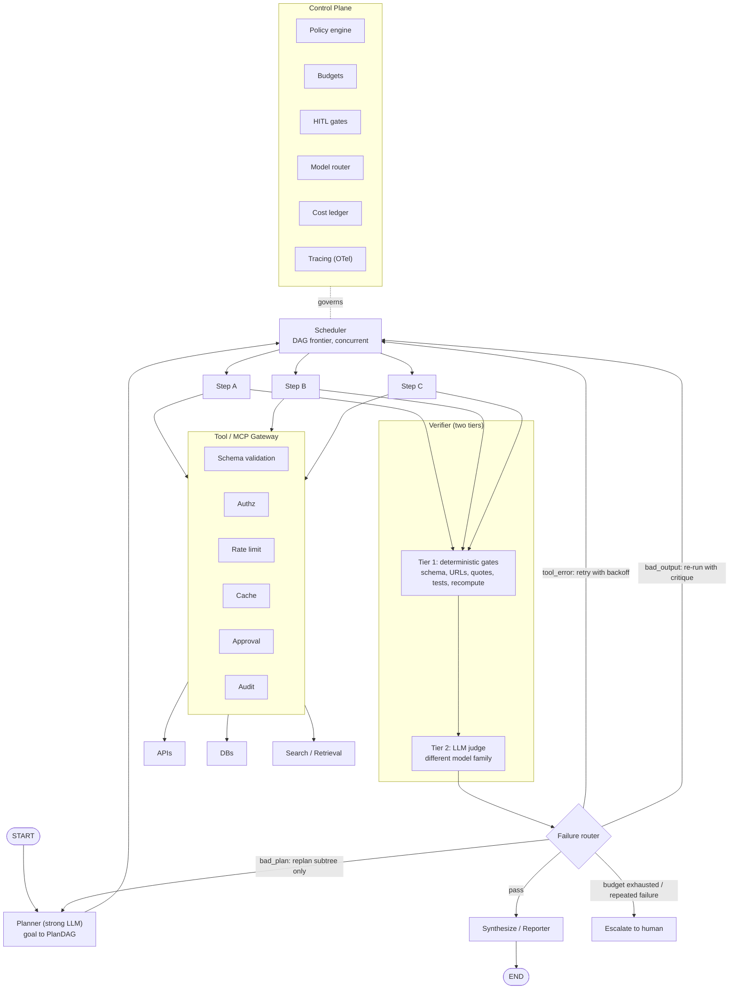
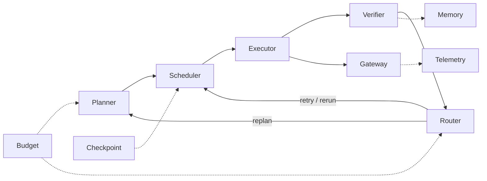
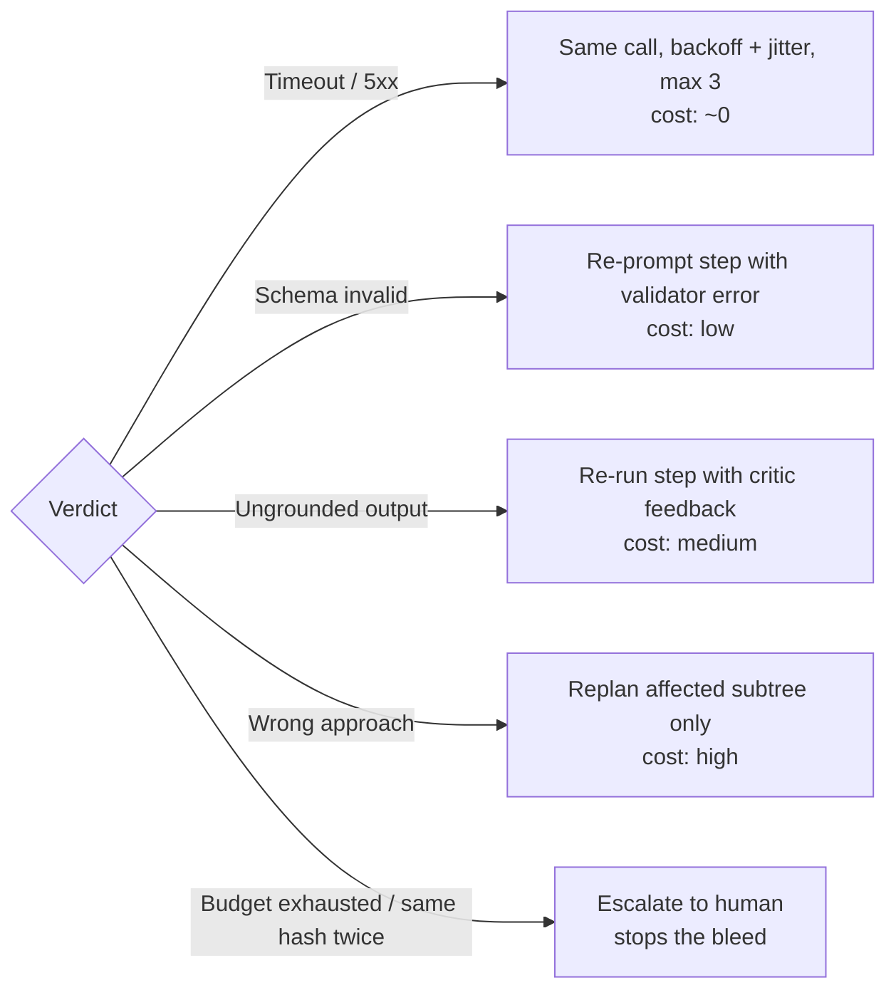
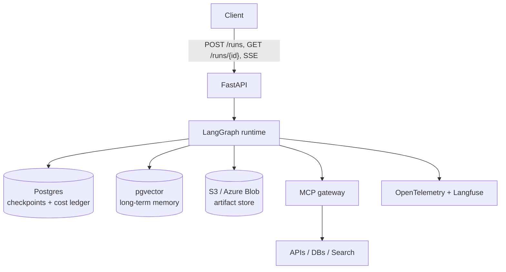

# Agent Harness: Architecture Diagram

A durable, policy-enforced runtime for multi-agent workflows. Workflows are declared in YAML, compiled into a DAG, executed by a scheduler, and verified by a two-tier critic before anything is returned.

## 1. System overview



## 2. Core loop (arc view)

Components on one line; each arc is a handoff. `->` marks direction.

```text
CORE LOOP
  Planner -> Scheduler -> Executor -> Verifier -> Router
  Router -> Scheduler   (retry step / re-run with critique)
  Router -> Planner     (replan subtree)
  Executor -> Gateway   (every tool call)

SUPPORT LAYER
  Budget     -> Planner      (limits on replans)
  Budget     -> Router       (exhaustion escalates to human)
  Checkpoint -> Scheduler    (resume, replay, fork)
  Verifier   -> Memory       (write only after pass)
  Gateway    -> Telemetry    (audit, spans, cost)
```



## 3. Failure routing



Loop detection: hash `(step_id, args, error)`. The same hash seen twice means no further retry.

## 4. Model routing

| Tier | Used for |
|---|---|
| strong | Planner, Critic |
| strong_alt | Judge (different family from producer) |
| mid | Analysis, coding, reporting |
| small | Routing, classification, extraction, formatting |

## 5. Deployment stack



## 6. Repo layout

```text
agent-harness/
├── README.md
├── pyproject.toml
├── workflows/        market_research_report.yaml
├── harness/
│   ├── state.py      typed State, PlanDAG, Step
│   ├── planner.py
│   ├── scheduler.py
│   ├── executor.py
│   ├── verifier/     gates.py, judge.py
│   ├── router.py     failure taxonomy + loop detection
│   ├── budget.py
│   ├── models.py     model router
│   ├── memory.py
│   ├── gateway/      policy.py, approval.py, mcp.py
│   ├── checkpoint.py
│   └── telemetry.py
├── api/main.py
├── evals/golden/
└── tests/
```

## 7. Build order

1. State schema, tool gateway, checkpointing
2. Planner, DAG scheduler, deterministic verifier
3. Failure router, budgets, loop detection
4. LLM critic, model router, caching
5. OTel tracing, cost ledger, eval harness
6. Human-approval UI
